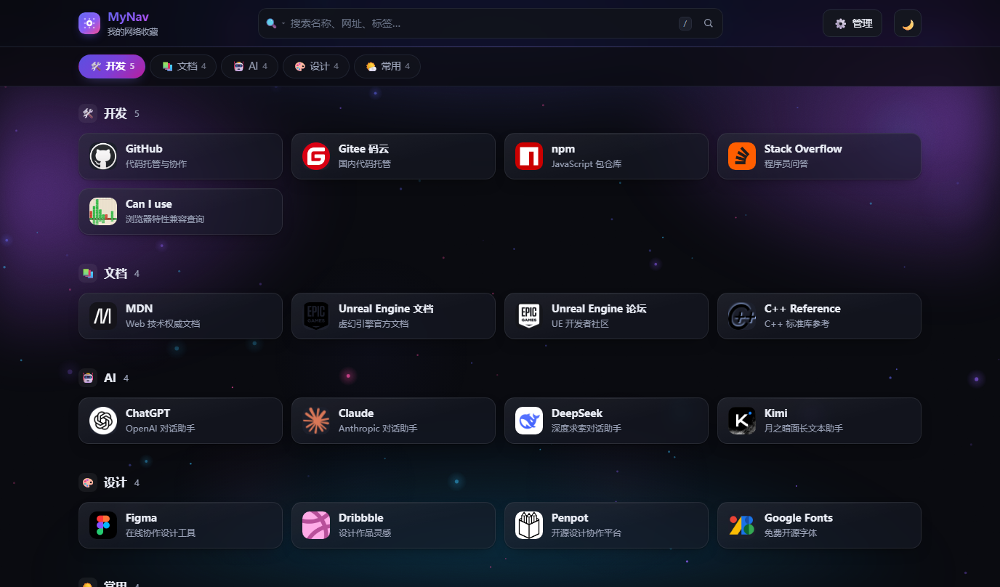
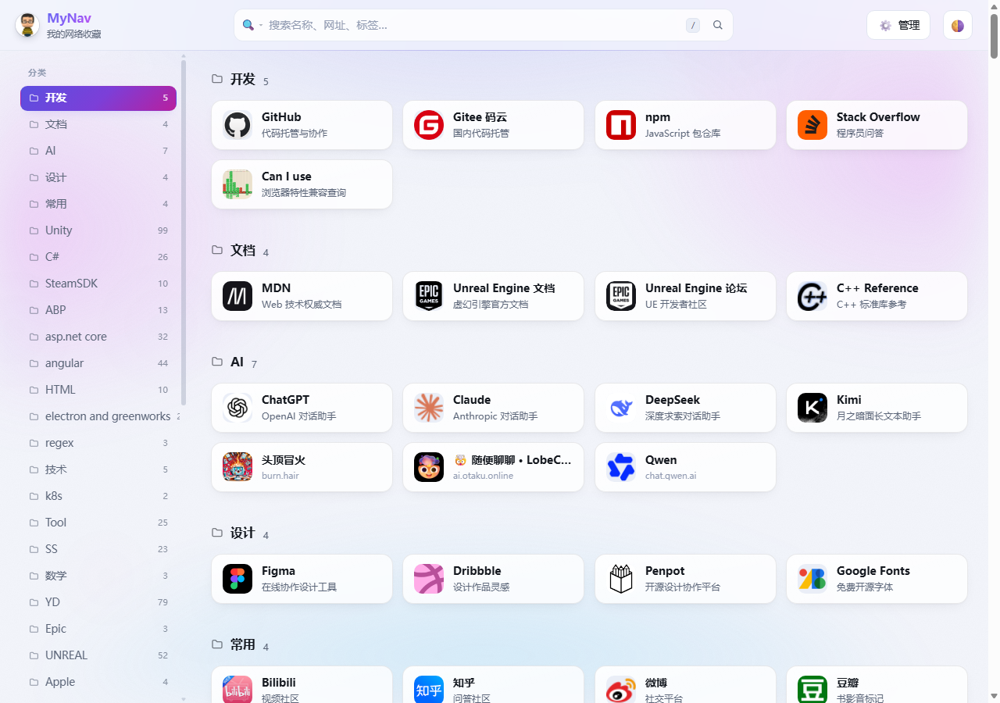
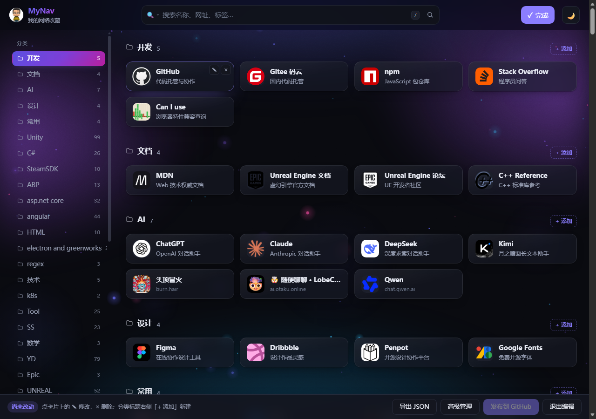
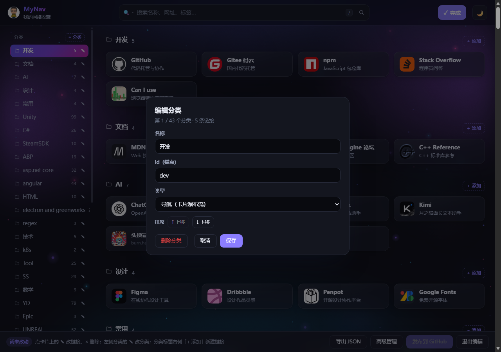
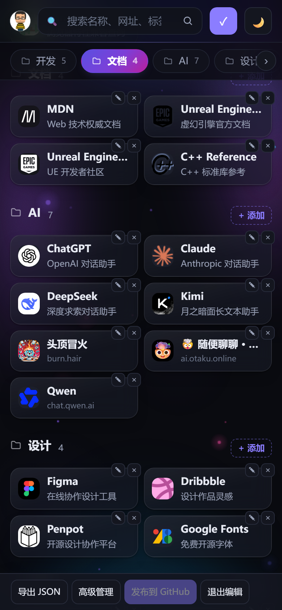

# MyNav · 个人导航站

纯静态、零依赖的个人网页导航站，部署在 GitHub Pages。




- 数据存在 `data/links.json`，是唯一真源
- 首页右上角 **✏️ 编辑** 可直接在页面上增删改**链接和分类**并一键发布（见「方式 A」）
- 附带**完整管理界面** `admin.html`，导入书签、批量编辑都在那里
- 也可以直接编辑 JSON，或从浏览器书签一键导入
- 页面用普通 `<script>` 引入数据，**双击 `index.html` 就能看效果**，不用起服务器
- 内置搜索（含 Ctrl+K 快速面板）、分类锚点、亮/暗主题、移动端适配
- **分类分两种**：导航类走卡片瀑布流；收藏夹类收进页底的紧凑单行列表，链接多时省 75% 高度
- **宽屏双栏、内容满宽**：左侧固定 214px 分类竖栏（跟随滚动、独立滚动条），右侧内容铺满整个视口，不再限宽 1200px
- **分类多也不挤**：宽屏竖栏自动滚动；窄屏（≤900px）收起成顶部横向标签栏，放不下时两侧渐隐 + 左右箭头，当前分类始终自动滚进视野
- 站点图标全部**本地落盘**（`data/icons/`），运行时零外部请求，不向第三方暴露访问
- 深色主题下的背景动效：极光漂移 + 星点闪烁 + 柔光雾团 + 偶发流星，跟随鼠标轻微视差

## 目录结构

```
MyNav/
├─ index.html                  导航站页面
├─ admin.html                  可视化管理界面
├─ assets/
│  ├─ style.css                站点样式（主题变量集中在文件顶部）
│  ├─ app.js                   渲染 / 搜索 / 主题逻辑
│  ├─ logo.png                 品牌头像（顶栏 + 管理页，圆形）
│  ├─ favicon.png              浏览器标签图标（64×64）
│  ├─ apple-touch-icon.png     添加到主屏时的图标（180×180）
│  ├─ editor.js                首页编辑模式（链接 / 分类增删改 + 一键发布）
│  ├─ admin.css                管理界面样式
│  └─ admin.js                 管理界面逻辑
├─ data/
│  ├─ links.json               ★ 数据真源，改这个
│  ├─ links.schema.json        编辑器用的 JSON Schema（补全 + 校验）
│  ├─ links.js                 由 links.json 生成，供页面 <script> 引入
│  └─ icons/                   站点图标（fetch-icons 抓取 / 导入书签落盘）
├─ tools/
│  ├─ build-data.mjs           links.json → links.js（含数据校验）
│  ├─ fetch-icons.mjs          抓取每个链接的真实站点图标到 data/icons/（只抓导航类，跳过收藏夹类；加 --include-fav 可强制包含）
│  └─ import-bookmarks.mjs     浏览器书签导入
├─ .github/workflows/pages.yml GitHub Pages 自动部署
├─ .nojekyll                   关闭 Jekyll 处理
└─ README.md
```

## 1. 背景动效

页面背景是一块全屏 `<canvas id="bgfx">`，与 CSS 极光层叠加：

| 元素 | 行为 |
|---|---|
| 星点 | 数量随屏幕面积自适应（24~180 颗），缓慢上浮 + 明暗呼吸；大星带光晕 |
| 光尘 | 4~14 团大半径柔光，极慢漂移与呼吸，负责填满卡片之间的空白 |
| 流星 | 每 5.5~14.5 秒随机来一颗，淡出收尾 |
| 鼠标视差 | 整体最多偏移 ±16px，鼠标移动时轻微跟随 |

几条约束：

- **浅色主题下不画星点**，只保留柔光雾团（浅底上的半透明彩点会像屏幕灰尘）
- 切到后台标签页（`document.hidden`）会暂停动画，不占 CPU
- 系统开启「减少动态效果」（`prefers-reduced-motion`）时只画一帧静态星点
- 换主题时颜色强度会自动调整（暗色 1.0 / 浅色 0.34）

## 2. 本地预览

**双击 `index.html`** 即可，无需安装任何东西。

> 为什么不用 `fetch('data/links.json')`？因为浏览器在 `file://` 下会用 CORS 拦掉 fetch。
> 所以数据被编译成 `data/links.js`（`window.NAV_DATA = {...}`），用 `<script>` 引入就没有这个限制。

## 3. 搜索与快捷操作

### 顶栏搜索框

- **边打边筛**：输入即过滤，支持空格分隔的多个关键词（同时命中才算）
- **回车直接开**：有结果就打开第一条；没有结果则自动打开快速搜索面板
- **右侧放大镜按钮**：效果同回车
- **左侧 🔍 按钮**：切换搜索范围 —— 站内搜索 / Google / Bing / 百度，选择会被记住
  - 选外部引擎时，回车会在新标签页打开对应搜索结果页
- 页面任意位置按 **`/`** 可聚焦顶栏搜索框，按 **Esc** 清空

### Ctrl + K 快速搜索

在任何页面按 **Ctrl + K**（macOS 用 **⌘ + K**）弹出搜索面板：

| 操作 | 效果 |
|---|---|
| 直接输入 | 实时模糊搜索 |
| ↑ / ↓ 或 Tab | 上下选择（首尾循环） |
| Enter | 在新标签页打开选中项 |
| Esc 或点遮罩 | 关闭面板 |
| 空输入打开 | 先列「最近打开」，再列全部链接 |

**模糊匹配规则**（优先级从高到低）：

1. 名称以关键词开头：`git` → GitHub
2. 名称/网址/标签包含关键词：`bilibili` → Bilibili
3. 词首缩写：`ue` → Unreal Engine，`so` → Stack Overflow
4. 长词子序列（3 个字以上）：`ghb` → GitHub

搜索范围覆盖名称、网址、描述、标签、关键词、分类名；命中的字符会高亮显示。

---

## 4. 四种修改方式

### 方式 A：首页直接编辑（最快）

点首页右上角的 **✏️ 编辑** 进入编辑模式：

**链接**：

- 每张卡片右上角出现 **✎**（修改）和 **×**（删除）；每个分类标题右侧出现 **+ 添加**
- 桌面端鼠标移到卡片上按钮才出现；触屏设备上常显（按钮飘在卡片外沿，不挡文字）

**分类**：

- 左侧栏每个分类右侧出现 **✎**，顶部出现 **+ 分类**
- 点 **✎** 打开分类弹窗：改名、改 id（锚点）、切换导航 / 收藏夹类型、**↑↓ 调整顺序**、删除
- 删分类时若下面还有链接，会先提示「将一起删除 N 条链接」
- 新建的分类即使还没有链接也会立刻显示（退出编辑模式后自动隐藏空分类）

**通用**：

- 底部工具条：**导出 JSON**、**高级管理**（跳转 `admin.html`）、**发布到 GitHub**、**退出编辑**
- 改动先存在浏览器内存里，工具条会显示「已改 N 处」；点 **发布到 GitHub** 提交 `data/links.json`，约 1 分钟后线上生效，仓库里会多一条 `chore(data): 通过首页编辑模式更新导航数据`
- 第一次发布要填仓库名（如 `kefengwei/MyNav`）、分支和 token，勾了「记住在本机」下次免填（与 `admin.html` 共用同一份配置）
- 有未发布的改动时，退出编辑或关闭标签页会弹确认
- 分类和链接的改动会在**同一次提交**里发布



分类弹窗（改名 / 改 id / 切换类型 / 调顺序 / 删除）：



触屏设备上按钮常显，飘在卡片外沿、不占正文宽度：



### 方式 B：完整管理界面（admin.html）

首页编辑模式下点工具条的 **高级管理**，或直接双击打开 `admin.html`，部署后也可以访问 `https://kefengwei.github.io/MyNav/admin.html`。

- 左侧选分类，右侧直接改名称、网址、描述、标签；分类可改名、改 id、切换类型
- 分类编辑器里的 **类型** 下拉可切换「🧭 导航（卡片瀑布流）」/「📁 收藏夹（紧凑列表）」，收藏夹类在左侧会带「收藏」小徽标
- 改完有三种出口：
  1. **下载 JSON** → 保存后覆盖 `data/links.json`
  2. **打开 / 保存文件** → 直接写盘（需用 `https` 或 `http://localhost` 打开，浏览器才允许）
  3. **发布到 GitHub** → 填一次 token，直接提交 `data/links.json`，CI 自动重建部署（`file://` 下也能用）
- **数据来源**：用 `http(s)` 或 `localhost` 打开时直接读真源 `data/links.json`；
  `file://` 双击打开时读构建产物 `data/links.js`，所以手改过 JSON 后要先跑一次 `build-data`
- 发布用的 token 只存在**你这台机器的浏览器**里（localStorage），不会进仓库
  - 建 token：GitHub → Settings → Developer settings → **Personal access tokens → Fine-grained tokens**
  - Repository access 选这个仓库；Permissions → **Contents: Read and write**
  - 公共电脑上不要勾「记住在本机」

### 方式 C：手改 JSON

编辑 `data/links.json`，然后生成页面用的 `data/links.js`：

```bash
node tools/build-data.mjs           # 校验 + 生成 links.js
node tools/build-data.mjs --check   # 只校验，并检查 links.js 是否已同步
node tools/build-data.mjs --stamp   # 顺便把 meta.updated 写成今天
```

用 VS Code 打开 `data/links.json` 会有字段补全和红线校验（靠 `$schema` 指向 `links.schema.json`）。

### 方式 D：导入浏览器书签

有两种入口，**行为不一样**：管理界面是「合并」，命令行是「整份覆盖」。

#### C-1 管理界面导入（推荐，合并）

1. 打开 `admin.html`（首页编辑模式的「高级管理」，或页脚的「管理」）
2. 点顶栏 **导入书签**
3. 选文件，或直接把文件拖进虚线框
4. 看预览：多少条能导入、多少条因重复被跳过、会合并或新建哪些分类
5. 点 **导入**，再点 **保存文件**（或「发布到 GitHub」）

| 来源 | 文件 |
|---|---|
| Chrome / Edge / Firefox / Safari | 导出的书签 `.html` |
| Chrome / Edge | `Bookmarks`（无扩展名的 JSON） |

规则：

- 书签文件夹名 → 分类名，取**最深一层**（`书签栏/前端/Vue/x` → `Vue`）
- 与现有分类**同名则合并追加**，不同名才新建分类
- 重复网址自动跳过（忽略主机大小写和末尾斜杠）；`chrome://`、`javascript:` 等非网页链接丢弃
- Firefox 书签的标签（`TAGS` 属性）会一起导入成 `tags`
- 默认**自动生成标签与关键词**（见下），导入后仍可在输入框里逐条改
- 默认**不保留**书签自带的小图标，交给 CI 抓 128px 高清图；想保留就勾上「保留书签自带的图标」

##### 自动生成的标签与关键词从哪来

纯本地规则推断，不联网、不调用 AI。生成结果在导入前的预览里能看到前 4 条示例。

**标签**（`tags`）最多 3 个：

1. 语义分类：代码托管、视频、设计、字体、包管理、问答、文档、社区、百科、AI、游戏、部署、社交、翻译、素材、资讯、邮箱、音乐、购物
2. 技术栈词：react / vue / javascript / python / rust / c++ / docker / kubernetes 等 36 个
3. 都没命中时，退化成书签所在的文件夹名

**关键词**（`keywords`）最多 5 个，用空格分隔：

- 域名主体（`dev.epicgames.com` → `epicgames`，`xxx.com.cn` 这类二级后缀也能正确取到 `xxx`）
- 名称里的英文单词（`Stack Overflow` → `stack`、`overflow`）

例：

| 名称 | 网址 | 生成 tags | 生成 keywords |
|---|---|---|---|
| Rust 官方文档 | doc.rust-lang.org | 文档、rust | rust-lang rust |
| Tailwind CSS | tailwindcss.com | css、tailwind | tailwindcss tailwind css |
| 维基百科 | zh.wikipedia.org | 百科 | wikipedia |
| 淘宝 | taobao.com | 购物 | taobao |
| Godot 引擎 | godotengine.org | 游戏 | godotengine godot |

#### C-2 命令行导入（一次性替换整份数据）

适合第一次从旧导航站全量搬过来。注意它会**覆盖** `data/links.json`，先备份。

1. 打开 `edge://favorites` 或 `chrome://bookmarks`
2. 右上角菜单 → **导出书签**，得到 `.html` 文件
3. 在仓库根目录执行：

```bash
node tools/import-bookmarks.mjs 你的书签.html
```

也可以直接读 Chrome/Edge 的 `Bookmarks` 文件（无扩展名的 JSON）：

```bash
node tools/import-bookmarks.mjs "C:/Users/你/AppData/Local/Microsoft/Edge/User Data/Default/Bookmarks"
```

| 参数 | 说明 |
|---|---|
| `--depth 1` | 只按第一层文件夹分类；默认取最深的一层 |
| `--no-icons` | 不导出图标，全部用首字母色块 |
| `--out <path>` | 输出到别的文件，默认 `data/links.json` |
| `--title` / `--subtitle` | 站点标题 / 副标题（不给则沿用已有值） |
| `--dry-run` | 只打印统计和分类预览，不写文件 |

> 脚本会跳过 `chrome://`、`edge://`、`javascript:`、`file:` 等非 http(s) 链接，并按 URL 去重。
> 书签自带的图标会解码到 `data/icons/`，**不依赖外部 favicon 服务**，国内可用、不外泄访问记录。
> 导入会**覆盖** `data/links.json`，先备份再导出。

### 图标从哪来

页面上每个图标都是 `data/icons/` 下的**本地文件**，运行时零外部请求，不把访问记录送给任何第三方。

三种来源：

1. **导入书签**时顺带落盘（浏览器缓存里的图标）
2. **自动抓取**——新加的链接把 `icon` 留空，然后运行：

```bash
node tools/fetch-icons.mjs                       # 只处理还没有图标的链接
node tools/fetch-icons.mjs --include-fav         # 连收藏夹类一起抓
node tools/fetch-icons.mjs --all                 # 全部重新抓（站点换 logo 时用）
node tools/fetch-icons.mjs --force               # 强制覆盖已有文件
node tools/fetch-icons.mjs --dry-run             # 只看会抓哪些，不写盘
node tools/fetch-icons.mjs --concurrency=24      # 并发数，默认 16
node tools/fetch-icons.mjs --timeout=20000       # 单请求超时毫秒，默认 8000
```

   抓取顺序（命中即停）：`apple-touch-icon` → `<link rel="icon">` → `/apple-touch-icon.png` → `/favicon.ico` → `favicon.im` 兜底。
   首页解析、`/apple-touch-icon.png`、`favicon.im` 三路**并发发出**，慢站点不会被逐个超时拖死；实测 167 条缺失链接从“几分钟跑不完”降到 **86 秒抓完**。

   > 抓不到时 `favicon.im` 会返回一张「灰色圆形 + 斜体 f」的占位 SVG，以及个别站点会把 404 网页当图标返回。这两类和过小的文件都会被丢弃，**宁可留首字母色块，也不放一张假图标**。

3. **CI 自动补全**——**加完链接只改 JSON 就行，不用跑命令**。GitHub Actions 在每次构建时会先跑一遍 `fetch-icons`，缺的图标由机器人在海外网络抓取（`favicon.im` 在那边更通），然后自动提交回仓库：

```
chore(icons): 自动补全站点图标 [skip ci]
```

   这一步是幂等的：所有链接都有图标时什么都不做，也不会产生空提交。

4. **手动指定**：`"icon": "assets/xxx.svg"`，或者 `"icon": "🚀"`；留空则显示首字母色块

> `favicon.im` 只在直连被 Cloudflare 拦截、或站点不给图标时才用，而且**只在构建时访问一次**——抓到的图存进仓库，访问你站点的人不会请求它。
> 个别站点（如 Epic 论坛）的图标是白色透明 logo，浅色主题下看不见，`style.css` 里对这类文件单独配了深色底。

## 5. 数据字段

```jsonc
{
  "$schema": "./links.schema.json",
  "meta": {
    "title": "MyNav",              // 浏览器标签页标题
    "subtitle": "我的网络收藏",     // 顶栏副标题
    "updated": "2026-10-21"        // 页脚显示，可省略
  },
  "categories": [
    {
      "id": "dev",                 // 锚点 id：字母/数字/下划线/连字符，唯一
      "name": "开发",               // 分类名
      "type": "nav",               // 可选："nav" 导航（卡片瀑布流，默认）/"fav" 收藏夹（页底紧凑列表），nav 可省略
      "links": [
        {
          "name": "GitHub",
          "url": "https://github.com",   // 必须是 http:// 或 https://
          "desc": "代码托管",             // 可选
          "icon": "data/icons/x.png",     // 可选：本地图片路径 / data URI / emoji，留空用首字母色块
          "tags": ["git"],                // 可选，参与搜索
          "keywords": "gh"                // 可选，额外搜索词（如拼音首字母）
        }
      ]
    }
  ]
}
```

没填 `icon` 的链接会自动生成**首字母色块**，默认状态不加载任何外部资源。

`type` 只认这两个值，写错会让 `build-data` 校验失败。**收藏夹类**渲染在页面底部的「收藏夹」区块：每条只占一行（16px 图标 + 名称 + 域名），比卡片省约 75% 高度，适合放「攒着没怎么用但不想删」的站点。

> 分类**不再有 emoji 字段**——所有分类的标签和标题统一显示同一个文件夹图标，收藏夹类靠标签栏里的虚线边框区分。旧的 `emoji` 字段留着不报错，但不起任何作用（`build-data` 会提示已废弃）。

## 6. 部署到 GitHub Pages

1. 在 GitHub 新建一个 **public** 仓库，名字建议就叫 `MyNav`
2. 本地初始化并推送（**由你执行**）：

   ```bash
   cd G:/Github/MyNav
   git init -b main
   git add -A
   git commit -m "feat: 初始化 MyNav 导航站"
   git remote add origin https://github.com/kefengwei/MyNav.git
   git push -u origin main
   ```

3. 仓库页面 → **Settings → Pages → Source** 选 **GitHub Actions**
4. 打开 **Actions** 标签，等 `Deploy to GitHub Pages` 变绿
5. 访问 `https://kefengwei.github.io/MyNav/`

之后每次推送 `main` 会自动重建部署。构建时 CI 会重新执行 `node tools/build-data.mjs`，
所以**只要 `links.json` 推上去了，即使忘了本地生成 `links.js` 也是对的**；
数据有问题（缺 name/url、id 重复）会直接构建失败，不会把坏页面发出去。

> 免费账号的 GitHub Pages 只支持 **public** 仓库。
> 所有资源都是相对路径，仓库名不必叫 `MyNav`。

> **关于机器人提交**：workflow 里有一步 `Commit fetched icons`，抓到新图标时会以 `github-actions[bot]` 身份提交 `data/links.json` + `data/icons/`。
> 你在本地 pull 时会看到这条提交，属于正常现象。
> 如果想关掉，删掉 `.github/workflows/pages.yml` 里的 `Fetch missing icons` 和 `Commit fetched icons` 两步即可，图标就得手动跑 `node tools/fetch-icons.mjs`。

## 7. 自定义

| 想改什么 | 改哪里 |
|---|---|
| 标题 / 副标题 / 日期 | `data/links.json` 的 `meta`，或管理界面左下角 |
| 颜色、圆角、间距 | `assets/style.css` 顶部的 CSS 变量 |
| 每行卡片数量 | `assets/style.css` 中 `.grid` 的 `minmax(232px, 1fr)` |
| 默认主题 | `assets/app.js` 中 `THEMES`（auto/light/dark） |
| Key 快捷搜索 | `/` 聚焦搜索框，`Esc` 清空 |

## 常见问题

**Q：双击 `index.html`，数据不显示？**
A：数据走 `<script src="data/links.js">`，不走 `fetch`，`file://` 下也能渲染。若空白，检查 `data/links.js` 是否存在——手改完 `links.json` 后要先跑 `node tools/build-data.mjs`。

**Q：构建日志里出现 `remote: Permission to xxx denied`？**

A：仓库 **Settings → Actions → General → Workflow permissions** 要选 **Read and write permissions**，否则机器人 token 没有 push 权限。这一步失败不影响部署（已加 `continue-on-error`），只是图标不会被提交回仓库。

**Q：管理界面里「打开 / 保存文件」按钮不见了？**
A：那是 File System Access API，只在 `https` 或 `http://localhost` 下可用。用 `file://` 双击打开时会自动隐藏，改用「下载 JSON」。

**Q：图标显示成方块？**
A：说明 `icon` 路径不对或导入时用了 `--no-icons`。删掉该条目的 `icon` 字段即可回退到首字母色块。

**Q：中文分类名能搜吗？**
A：能。搜索匹配 名称 / URL / 描述 / tags / keywords。想支持拼音首字母，在某条链接的 `keywords` 里加上即可。

**Q：分类太多，标签栏会挤爆吗？**

A：不会，分两种布局：宽屏（>900px）时分类是左侧 214px 竖栏，43 个分类也只是一列，超出屏幕高度时竖栏自己滚动；窄屏（≤900px）时收起成顶部横向条，放不下就横向滚动，右侧渐隐 + 出现 `›` 箭头，点箭头按 70% 宽度翻页，滚到末尾 `›` 换成 `‹`。两种布局下，滚动页面或点击分类时当前分类都会自动滚进可视区。

**Q：`links.js` 要不要提交到仓库？**
A：提交。这样别人 clone 后双击 `index.html` 就能看；CI 部署时会用 `links.json` 重新生成，覆盖提交的版本。

## 许可

个人使用，随意修改。
